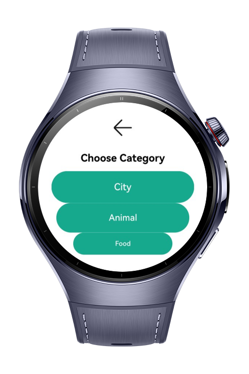
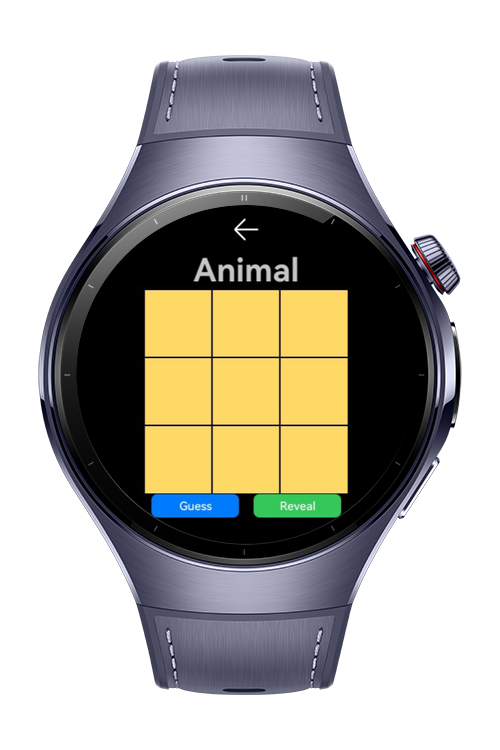
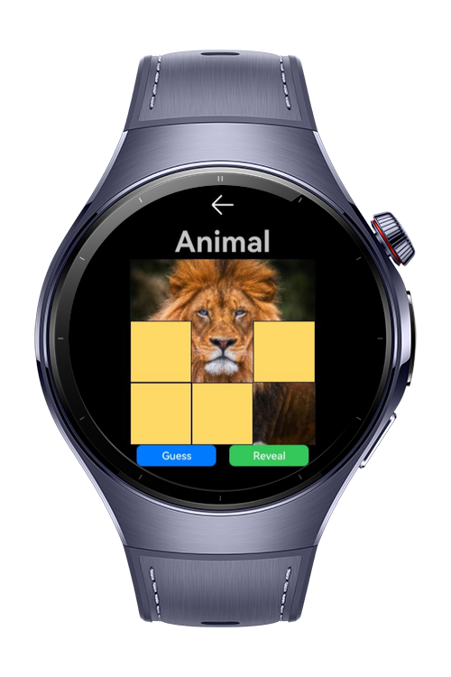
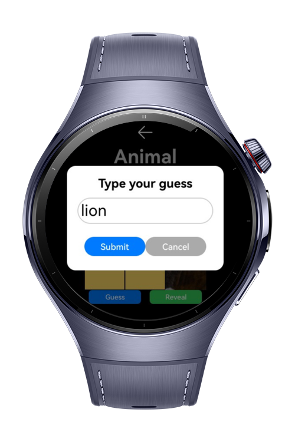

> **Note:** To access all shared projects, get information about environment setup, and view other guides, please visit [Explore-In-HMOS Index](https://github.com/Explore-In-HMOS/hmos-index).

# Peek & Guess App

The PeekAndGuess app is a casual wearable game where players select a category (Animal, Food, or City), uncover tiles from a hidden image, and try to guess the correct answer with the help of haptic and audio feedback; it provides quick entertainment in short sessions, demonstrates cognitive engagement, and showcases HarmonyOS capabilities for multimedia, interaction, and smooth user experience on smartwatches.

# Preview

<div>
    
    
    
    
</div>

# Use Cases

- **Casual Puzzle Game**: Entertain users with a quick and engaging tile-reveal guessing challenge on wearables.
- **Cognitive Engagement**: Enhance pattern recognition, memory, and decision-making by revealing minimal tiles before guessing.
- **Wearable Interaction Demo**: Demonstrates HarmonyOS integration of haptics, audio feedback, and touch interactions in a simple game scenario.

# Technology

## Stack
**Languages**: ArkTS  
**Framework**: HarmonyOS SDK 5.1.0(16)
**Tools**: DevEco Studio Version 5.1.0.240SP1
**Libraries/Kits**:
- Haptic Kit 
- Audio Kit 
- AbilityKit & Router
- ArkUI Kit

## Required Permissions
- `ohos.permission.VIBRATE`
- `ohos.permission.ACTIVITY_MOTION`

# Directory Structure
```
PeekAndGuess/
├── entry/
│ ├── src/main/
│ │ ├── ets/
│ │ │ ├── entryability/EntryAbility.ets
│ │ │ ├── pages/
│ │ │ │ ├── HomePage.ets
│ │ │ │ ├── CategoryPage.ets
│ │ │ │ └── GamePage.ets
│ │ │ └── services/
│ │ │ ├── AudioService.ets
│ │ │ └── HapticsService.ets
│ │ └── resources/
│ │ └── rawfile/
│ │ ├── correct.mp3
│ │ ├── wrong.mp3
│ │ ├── congrats.mp3
│ │ └── game_over.mp3
```
# Constraints and Restrictions

## Supported Device
- Huawei Watch 5

# License

**PeekAndGuess** is distributed under the terms of the **MIT License**.  
See the [LICENCE](LICENCE) file for more information.  